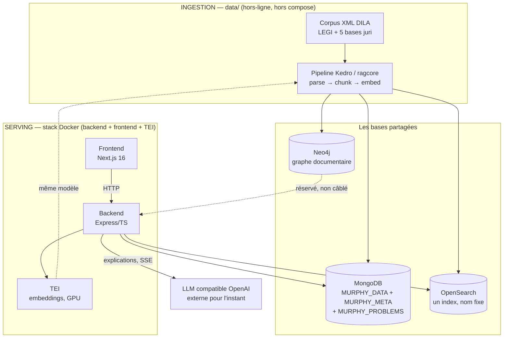

# Architecture système — Murphy

Vue d'ensemble du système complet. **La documentation technique détaillée a un dossier
par projet**, à côté de ce document :

- [`backend/`](backend/README.md) — le serving (API de recherche Express/TS)
- [`frontend/`](frontend/README.md) — l'UI (Next.js) : la recherche et ses onglets Dockview
- [`data/`](data/README.md) — l'ingestion (Kedro + ragcore)

Ce document ne couvre que ce qu'aucun projet ne peut dire seul : comment les deux
moitiés du système s'articulent.

## Les deux moitiés

Murphy est un moteur de recherche sur les données juridiques françaises (corpus
DILA/LEGIFRANCE) : une question donne des documents classés et leurs passages (ADR-028).
L'utilisateur peut en choisir certains, et un LLM les lui résume et les lui explique
(ADR-033).
Deux systèmes **qui ne partagent que des bases de données — aucun code, aucun appel** :



- **Ingestion** (`data/`) : un pipeline Kedro qui tourne à la demande, sur l'hôte, hors
  de la stack Docker. Il lit le corpus XML, le parse, le découpe, l'embarque et peuple
  les trois bases. Détails : [`data/ARCHITECTURE.md`](data/ARCHITECTURE.md).
- **Serving** (`backend/` + `frontend/` + compose) : stateless, chaque requête recalcule
  le pipeline embed → recherche hybride → fetch → page de résultats ; le texte entier
  d'un document est servi à la demande. Détails :
  [`backend/ARCHITECTURE.md`](backend/ARCHITECTURE.md). Le frontend affiche les pages de
  résultats et ouvre chaque document dans un onglet (ADR-032) : voir
  [`frontend/ARCHITECTURE.md`](frontend/ARCHITECTURE.md).

## Les contrats entre les deux

C'est la seule zone où une modification d'un côté casse l'autre. Quatre contrats :

| Contrat | Écrit par l'ingestion | Lu par le serving |
|---|---|---|
| **Nom de l'index** | `OPENSEARCH_INDEX` (`.env.dev`), créé et rempli par l'ingestion, avec son mapping et ses analyseurs | La même variable. Au boot (`backend/src/infra/opensearch.ts`), refus de démarrer si l'index n'existe pas ; le backend écrit le pipeline de recherche RRF (ADR-028 §6). |
| **Documents et passages** | Un document OpenSearch par document Mongo : `identifier`, `document_type`, `nature`, passages (`chunk_id`, `char_start`, `char_end`) imbriqués avec leurs vecteurs ([`index-opensearch.md`](data/reference/index-opensearch.md)) | La requête hybride à quatre sous-requêtes ; `_source` et `inner_hits` n'en rendent que l'identité et les offsets des passages |
| **Contenu** | Mongo `MURPHY_DATA.documents` : un document entier par `identifier`, avec `content_length` (sa longueur en points de code) et `parent_text_title` (ADR-033) | Le titre et le texte des documents trouvés ; le texte d'un passage est `content[char_start:char_end]` (points de code). Les passages partent dans la page de résultats, le document entier par `GET /documents/:identifier`. `content_length` alimente la jauge du budget ; les explications lisent aussi le type, la nature, `parent_text_title` et les métadonnées d'une liste blanche |
| **Modèle d'embedding** | `microsoft/harrier-oss-v1-0.6b`, Cosine — vérifié contre TEI au démarrage du run ; la dimension (1024) est mesurée auprès de TEI et fixée à la création de l'index. Passages et titres sans consigne | Le même modèle via le même conteneur TEI ; la question porte la consigne `EMBEDDING_QUERY_INSTRUCTION` (ADR-031) |

Le modèle d'embedding est le contrat le plus fragile : question et corpus doivent être
embarqués par le **même** modèle. Changer de modèle impose une réingestion complète ;
changer la consigne de la question ne touche que le backend. C'est pourquoi il n'y a qu'**un** fichier
d'environnement (`.env.dev` à la racine, gitignoré), partagé par le conteneur TEI, le
backend et le pipeline d'ingestion.

Neo4j est peuplé par l'ingestion (nœuds documents + arêtes typées par verbe + relations
pendantes) mais **pas encore câblé** dans le chemin de requête du backend — réservé à
l'enrichissement de contexte par graphe.

## La stack Docker (racine du repo)

`docker-compose.base.yml` + overrides `.dev.yml` / `.prod.yml` : backend, frontend,
MongoDB, OpenSearch (nœud unique, écrit par l'ingestion, lu par le backend : ADR-028)
et ses Dashboards
(dev seulement), Neo4j, TEI (GPU NVIDIA requis). L'ingestion n'est **pas** dans compose —
elle tourne sur l'hôte et parle aux bases via les ports publiés.

Scripts racine (`package.json`, tous exigent `.env.dev`) :

```bash
npm run up | watch | logs | status | down | build
```

Ports dev : frontend `3000`, backend `5000`, OpenSearch `9200` (plugin de
sécurité désactivé), OpenSearch Dashboards `5601`, Mongo `27017`, Neo4j `7474`/`7687`, TEI
`5001→80`.

### Production

Aucun script ne l'enveloppe : `docker compose -f docker-compose.base.yml -f
docker-compose.prod.yml --env-file .env.dev up -d --build` (et `down`
avec les mêmes options).

- **URL du backend fixée au build** : Next inline `NEXT_PUBLIC_API_URL` dans le bundle
  client. Compose la passe en argument de build ; la changer demande de reconstruire
  l'image frontend.
- **Ports publiés** : frontend `3000` et backend `5000`, car le navigateur appelle le
  backend directement. `CORS_ORIGIN` doit valoir l'origine publique du frontend. Les
  bases et TEI restent sur le réseau interne.
- **Pas de reverse proxy** tant que rien n'est déployé : ni TLS, ni `trust
  proxy` (`TRUST_PROXY` dans `backend/src/app.ts`).
- Les images tournent en utilisateur `node` ; `NODE_ENV` vient de la cible de build.
- **OpenSearch garde son plugin de sécurité**, mais ni le backend ni l'ingestion ne
  s'authentifient encore : à configurer avant tout déploiement.
- TEI a mis 278 s à être prêt avec `microsoft/harrier-oss-v1-0.6b` (mesuré sur une RTX
  3050), dont 88 s de téléchargement des poids sur un cache vide. Sa mémoire monte à
  4,1 Go pendant le chargement, puis retombe à 1,1 Go ; il occupe 1,4 Go de mémoire GPU
  (2,1 Go pendant le préchauffage). Un `mem_limit` de 2 Go l'empêchait de démarrer.

## Où vit quoi (un seul dépôt, ADR-016)

| Emplacement | Contenu |
|---|---|
| `docs/pilotage/ADR/` | Les **ADR** (les décisions d'architecture citées partout : ADR-011 régimes dev/prod, ADR-012 interrupteur d'embedding, …), indexés dans `INDEX.md` |
| `docs/pilotage/WIP/` | Le travail en cours (critiques, plans) |
| `docs/technical/` | Ce document — la vue système —, puis la documentation de chaque projet |
| `backend/`, `frontend/`, `data/` | Les projets. `backend` et `frontend` sont des npm workspaces (un seul lockfile à la racine) ; `data` est en Python |
| `packages/contract/` | `@murphy/contract` : le contrat backend ↔ frontend (schémas zod, types déduits), compilé, partagé par les deux workspaces. Trois sous-chemins : `search` (la requête, la réponse, le document), `explanations` (la requête d'explication) et `errors` (les codes d'erreur de l'API) |
| `docker-compose.*.yml` | La stack de serving |

Convention de documentation : chaque projet a son dossier `docs/technical/<projet>/`,
avec un `README.md` (index + opérations) et un `ARCHITECTURE.md` (vue d'ensemble du
sous-système) ; `data/` y ajoute `reference/` (les références détaillées). Le
`README.md` à la racine de chaque projet est un accueil qui renvoie à ce dossier.
