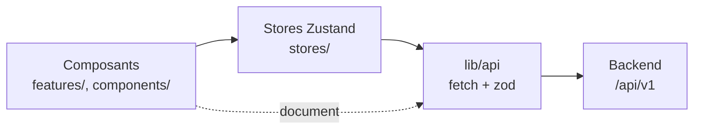

# Architecture — frontend

## Ce que c'est

L'interface du moteur de recherche de Murphy (ADR-032) : une question donne une page de
documents classés, avec leur meilleur passage ; un clic sur un titre ouvre le texte
entier dans un onglet, le passage surligné. Next.js 16 (App Router), React 19,
Tailwind v4, Dockview pour les onglets, Zustand pour l'état.

## Deux écrans, une seule route

`/` affiche l'**accueil** (logo et barre de recherche centrée) tant qu'aucune recherche
n'a été lancée, puis l'**espace de travail** (`features/workspace/SearchScreen.tsx`). Ce
sont deux états d'un même écran, pas deux routes : la question ne passe jamais par l'URL
(ADR-010). Un rechargement ramène à l'accueil, et rien n'est retenu d'une visite à
l'autre.

La première recherche ouvre l'espace de travail, même si elle échoue : la modale
d'erreur s'affiche sur une liste vide. L'en-tête de l'espace de travail porte la barre
de recherche et le sélecteur « Résultats par page ».

## Les couches



Les dépendances vont de l'interface vers les stores, puis vers `lib/api`, jamais dans
l'autre sens. Aucun composant n'appelle `fetch`.

- **`lib/api/request.ts:requestApi(path, init, schema)`** fait l'appel, puis valide le
  `data` de l'enveloppe avec un schéma de `@murphy/contract/search`. Un échec devient une
  `ApiError` qui porte un code :
  - pas de réponse : `NETWORK` (le seul code propre au frontend) ;
  - un statut d'échec : le code de l'API (`status.message`), ou `INTERNAL` s'il n'est pas
    au contrat ;
  - un JSON illisible ou un `data` hors schéma : `INTERNAL` ;
  - une requête annulée : l'erreur d'origine, que l'appelant ignore.
- **`lib/api/search.ts`** (`POST /search`) et **`lib/api/documents.ts`**
  (`GET /documents/:identifier`, l'identifiant encodé) l'emploient.
- **`stores/searchStore.ts`** détient la question, la page, la taille de page, le statut
  (`idle`, `loading`, `success`, `error`) et la réponse. Ses actions : `submit`,
  `goToPage`, `setPageSize` (qui revient à la page 1). Une requête annule la précédente
  (`AbortController`) : une réponse en retard n'écrase jamais la plus récente. Le backend
  n'en sait rien.
- **`stores/errorStore.ts`** détient le code d'erreur affiché.

Seul le contenu d'un document échappe au store : il appartient à son onglet, qui le
charge à chaque ouverture (`features/document/useDocumentContent.ts`), sans cache.

## Les erreurs : une modale

Une seule modale (`features/errors/ErrorDialog.tsx`), alimentée par `errorStore`, sert la
recherche comme les documents. Elle traduit le code en une phrase
(`features/errors/errorMessages.ts`) : la table est un
`Record<DisplayedErrorCode, string>`, si bien qu'un code ajouté au contrat casse le build
tant qu'il n'a pas de message. Le détail part dans `console.error`
(`lib/api/apiError.ts:reportApiError`) ; il n'y a pas de bouton « Réessayer ».

- **Après une erreur de recherche**, la liste est vidée et la question reste dans la
  barre.
- **Après une erreur de document**, l'onglet se ferme.

`components/ui/Modal.tsx` est la coquille commune : l'élément `<dialog>` et
`showModal()` (fond grisé, page inerte, focus piégé, Échap), un titre, un bouton
« Fermer », un contenu libre. Montée, elle est ouverte : c'est le parent qui décide de
l'afficher.

## L'espace de travail : Dockview

`features/workspace/Workspace.tsx` rend un `DockviewReact` (paquet `dockview-react`).
C'est un simple composant client : son rendu serveur est un `<div>` vide. Son thème est
le thème sombre de Dockview, recoloré par `.dockview-theme-murphy` dans `globals.css`
avec les couleurs du `@theme`.

**Seul `features/workspace/` importe Dockview.** Chaque état a un seul détenteur :
Dockview détient la disposition (les panneaux ouverts, leurs groupes, l'onglet actif),
les paramètres d'un onglet document portent ses données, et les stores détiennent le
reste.

### Le registre adapte les panneaux

`panelRegistry.tsx` associe à chaque type de panneau un adaptateur : il reçoit les props
de Dockview et rend le panneau métier avec des props simples, ses paramètres et ses
rappels. Les panneaux (`results/`, `document/`, `graph/`, `explanation/`) n'importent
ni Dockview, ni `workspace/`, ni un autre panneau.

| Type | Identifiant | Panneau | Ce que l'adaptateur lui passe |
|---|---|---|---|
| `results` | `results` | `ResultsPanel` | `onOpenDocument(result)` → `openDocument(containerApi, result)` |
| `graph` | `graph` | `GraphPanel` (vide) | — |
| `explanation` | `explanation` | `ExplanationPanel` (vide) | — |
| `document` | `document:<identifier>` | `DocumentPanel` | `identifier`, `passage`, `onError(code)` → la modale, puis la fermeture de l'onglet |

Les trois panneaux fixes ont pour identifiant leur type : chacun est unique. La
disposition par défaut (`defaultLayout.ts`) les ouvre dans un seul groupe, Résultats
actif. Graphe et Explication sont des amorces vides, qui auront chacune leur ADR.

### Les actions d'un groupe

- **Scinder** (`GroupActions.tsx`) déplace l'onglet actif dans un nouveau groupe, à
  droite, ou en dessous sur un écran étroit (`max-width: 640px`). Le bouton est désactivé
  quand le groupe n'a qu'un onglet.
- **Le menu « … »** rouvre dans ce groupe les panneaux fixes fermés partout
  (`useClosedFixedPanels.ts`, abonné aux ajouts et fermetures de panneaux). Tous les
  onglets se ferment, Résultats compris.
- **Un espace vide** n'a plus de groupe, donc plus de menu : le `watermark`
  (`Watermark.tsx`) propose la même liste.
- **L'onglet** (`PanelTab.tsx`) : une icône (celle du registre pour un panneau fixe,
  celle du document sinon), un titre tronqué avec le titre complet en infobulle, et un
  bouton de fermeture.

## L'onglet Résultats

`features/results/ResultsPanel.tsx` : la liste dans l'ordre du classement, puis la
pagination. Un résultat (`ResultItem.tsx`) aligne :

- un menu « … », sans option pour l'instant ;
- une pastille (`InForceDot.tsx`) : verte si `isInForce` vaut `true`, rouge s'il vaut
  `false`, aucune s'il est absent ;
- une icône (`documentIcons.ts`), choisie par la nature, sinon par le type. La table des
  natures est partielle et se complète au fil de l'eau ; celle des types est exhaustive
  et vérifiée par le compilateur ;
- le titre, en police mono, qui ouvre le document ;
- le premier passage, coupé à quelques lignes ; absent si le document n'en a pas.

**La pagination** (`Pagination.tsx`, `pageItems.ts`) affiche la première et la dernière
page, la page courante et ses voisines, avec une ellipse pour les trous. **Le
sélecteur** (`PageSizeSelect.tsx`, dans l'en-tête) propose les `pageSizes` de la réponse
et n'apparaît qu'après la première.

## L'onglet document

- **L'ouverture** (`workspace/documentTabs.tsx:openDocument`) : un onglet par document,
  `document:<identifier>`. S'il est déjà ouvert, il est activé. Sinon, il s'ouvre dans le
  groupe de Résultats, ou dans le groupe actif si Résultats est fermé. Ses paramètres :
  `{ identifier, documentType, nature, passage }`, où `passage` est le premier du
  résultat.
- **Le contenu** (`document/DocumentPanel.tsx`) : `GET /documents/:identifier` au
  montage, annulé au démontage. Le texte est affiché entier (`whitespace-pre-wrap`) ; le
  passage, découpé par ses offsets UTF-16 (`splitAroundPassage.ts`), est dans un
  `<mark>` amené au centre de l'onglet. Des offsets hors du texte le laissent entier,
  sans surlignage.
- **Une nouvelle recherche** laisse les onglets document ouverts.

## Arborescence

```
src/
├── app/                  # layout.tsx, page.tsx (rend SearchScreen), error.tsx (Error Boundary)
├── lib/
│   ├── api/              # requestApi, ApiError, search, documents, apiUrl
│   └── documentTypeLabels.ts
├── stores/               # searchStore, errorStore (Zustand, en mémoire)
├── features/
│   ├── home/             # HomeScreen
│   ├── workspace/        # SearchScreen, WorkspaceScreen, WorkspaceHeader, Workspace,
│   │                     # panelRegistry, documentTabs, defaultLayout, PanelTab,
│   │                     # GroupActions, Watermark, FixedPanelList, useClosedFixedPanels
│   ├── results/          # ResultsPanel, ResultList, ResultItem, InForceDot, DocumentIcon,
│   │                     # Pagination, PageSizeSelect
│   ├── document/         # DocumentPanel, useDocumentContent, splitAroundPassage
│   ├── graph/            # GraphPanel (vide)
│   ├── explanation/      # ExplanationPanel (vide)
│   └── errors/           # ErrorDialog, errorMessages
├── components/
│   ├── ui/               # SearchBar (+ useSearchInput), Modal : des briques sans métier
│   └── icons/            # Icon, AnimatedIcon (décoratives), ButtonIcon, AnimatedButtonIcon, Logo
└── styles/globals.css    # Tailwind v4 : @theme, @utility scrollbar, thème Dockview
```

## Styles et accessibilité

- **Couleurs** : le thème, unique et sombre, est déclaré dans le `@theme` de
  `globals.css`. Les composants emploient des classes Tailwind (`bg-secondary`,
  `text-tertiary`, `bg-highlight`…). Il n'y a pas de contexte de thème ni de style
  inline.
- **Polices** : Geist et Geist Mono, chargées par `next/font` dans `app/layout.tsx`.
- **Icônes** : `Icon` et `AnimatedIcon` sont décoratives (`alt=""`). Un bouton-icône
  porte son nom accessible (`ButtonIcon`, prop `label` → `aria-label`) ; la pastille de
  vigueur aussi (« En vigueur », « Pas en vigueur »).
- **Saisie** : la `SearchBar` est un `<form>`. « Entrée » soumet, une question vide
  n'est pas envoyée, et le champ garde la question après l'envoi
  (`components/ui/useSearchInput.ts`).
