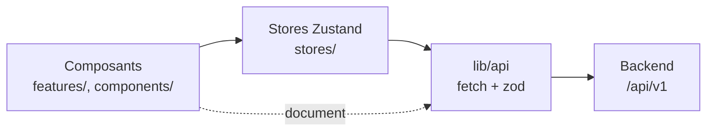

# Architecture — frontend

## Ce que c'est

L'interface du moteur de recherche de Murphy (ADR-032) : une question donne une page de
documents classés, avec leur meilleur passage ; un clic sur un titre ouvre le texte
entier dans un onglet, le passage surligné. L'utilisateur peut aussi choisir des
documents et en demander un résumé et des explications à un LLM (ADR-033). Next.js 16 (App Router), React 19,
Tailwind v4, Dockview pour les onglets, Zustand pour l'état.

## Deux écrans, une seule route

`/` affiche l'**accueil** (logo et barre de recherche centrée) tant qu'aucune recherche
n'a été lancée, puis l'**espace de travail** (`features/workspace/SearchScreen.tsx`). Ce
sont deux états d'un même écran, pas deux routes : la question ne passe jamais par l'URL
(ADR-010). Un rechargement ramène à l'accueil, et rien n'est retenu d'une visite à
l'autre.

La première recherche ouvre l'espace de travail, même si elle échoue : la modale
d'erreur s'affiche sur une liste vide. L'espace de travail n'a pas d'en-tête : la barre
de recherche et le sélecteur « Résultats par page » sont en haut de l'onglet Résultats.

## Les couches



Les dépendances vont de l'interface vers les stores, puis vers `lib/api`, jamais dans
l'autre sens. Aucun composant n'appelle `fetch`.

- **`lib/api/request.ts:requestApi(path, init, schema)`** fait l'appel, puis valide le
  `data` de l'enveloppe avec un schéma du contrat (`@murphy/contract/search`), et lit le
  code d'erreur avec `@murphy/contract/errors`. Un échec devient une
  `ApiError` qui porte un code :
  - pas de réponse : `NETWORK` (le seul code propre au frontend) ;
  - un statut d'échec : le code de l'API (`status.message`), ou `INTERNAL` s'il n'est pas
    au contrat ;
  - un JSON illisible ou un `data` hors schéma : `INTERNAL` ;
  - une requête annulée : l'erreur d'origine, que l'appelant ignore.
- **`lib/api/search.ts`** (`POST /search`) et **`lib/api/documents.ts`**
  (`GET /documents/:identifier`, l'identifiant encodé) l'emploient.
- **`stores/searchStore.ts`** détient la question, la page, la taille de page, le statut
  (`idle`, `loading`, `success`, `error`) et la réponse. Ses actions : `submit`,
  `goToPage`, `setPageSize` (qui revient à la page 1). Une requête annule la précédente
  (`AbortController`) : une réponse en retard n'écrase jamais la plus récente. Le backend
  n'en sait rien.
  Elle garde aussi le `contextBudget` de la dernière réponse, même après une erreur.
- **`stores/errorStore.ts`** détient le code d'erreur affiché.
- **`stores/selectionStore.ts`** détient la sélection : une liste ordonnée de documents,
  dans l'ordre des ajouts, sans leurs passages. Elle survit à une nouvelle recherche.
- **`stores/explanationStore.ts`** détient la conversation : une instance `Chat` de
  l'AI SDK, au niveau du module, sur le transport de `lib/api/explanations.ts` (voir
  « L'onglet Explications »).

Seul le contenu d'un document échappe au store : il appartient à son onglet, qui le
charge à chaque ouverture (`features/document/useDocumentContent.ts`), sans cache.

## Les erreurs : une modale

Une seule modale (`features/errors/ErrorDialog.tsx`), alimentée par `errorStore`, sert la
recherche comme les documents. Elle traduit le code en une phrase
(`features/errors/errorMessages.ts`) : la table est un
`Record<DisplayedErrorCode, string>`, si bien qu'un code ajouté au contrat casse le build
tant qu'il n'a pas de message. Le détail part dans `console.error`
(`lib/api/apiError.ts:reportApiError`) ; il n'y a pas de bouton « Réessayer ».

- **Après une erreur de recherche**, la liste est vidée et la question reste dans la
  barre.
- **Après une erreur de document**, l'onglet se ferme.
- **Après une erreur d'explication**, la réponse partielle est retirée et la question
  reste.

`components/ui/Modal.tsx` est la coquille commune : l'élément `<dialog>` et
`showModal()` (fond grisé, page inerte, focus piégé, Échap), un titre, un bouton
« Fermer », un contenu libre. Montée, elle est ouverte : c'est le parent qui décide de
l'afficher.

## L'espace de travail : Dockview

`features/workspace/Workspace.tsx` rend un `DockviewReact` (paquet `dockview-react`).
C'est un simple composant client : son rendu serveur est un `<div>` vide. Son thème est
le thème sombre de Dockview, recoloré par `.dockview-theme-murphy` dans `globals.css`
avec les couleurs du `@theme`.

**Seul `features/workspace/` importe Dockview.** Chaque état a un seul détenteur :
Dockview détient la disposition (les panneaux ouverts, leurs groupes, l'onglet actif),
les paramètres d'un onglet document portent ses données, et les stores détiennent le
reste.

### Le registre adapte les panneaux

`panelRegistry.tsx` associe à chaque type de panneau un adaptateur : il reçoit les props
de Dockview et rend le panneau métier avec des props simples, ses paramètres et ses
rappels. Les panneaux (`results/`, `document/`, `explanation/`) n'importent
ni Dockview, ni `workspace/`, ni un autre panneau.

| Type | Identifiant | Panneau | Ce que l'adaptateur lui passe |
|---|---|---|---|
| `results` | `results` | `ResultsPanel` | `onOpenDocument(result)` → `openDocument(containerApi, …)`, avec son premier passage |
| `explanation` | `explanation` | `ExplanationPanel` | `onOpenDocument(source)` → `openDocument(containerApi, source)`, sans passage |
| `document` | `document:<identifier>` | `DocumentPanel` | `identifier`, `passage`, `onError(code)` → la modale, puis la fermeture de l'onglet |

Les deux panneaux fixes ont pour identifiant leur type : chacun est unique. La
disposition par défaut (`defaultLayout.ts`) les ouvre dans un seul groupe, Recherche
actif. `showFixedPanel(api, kind)` active un panneau fixe, ou le rouvre s'il est fermé.

### La sidebar de la sélection

Elle vit **hors de Dockview**, à droite de l'espace de travail, pour rester visible
depuis tous les onglets. `Workspace.tsx` garde l'API de Dockview, reçue par `onReady`,
et rend `SelectionSidebarAdapter.tsx`, qui passe à `features/selection/` des rappels
simples : ouvrir un document, et « Résumer ».

### Les actions d'un groupe

- **Scinder** : un onglet glissé au bord d'un groupe ouvre un nouveau groupe (le
  glisser-déposer de Dockview, sans bouton).
- **Le menu « … »** (`GroupActions.tsx`) rouvre dans ce groupe les panneaux fixes
  fermés partout (`useClosedFixedPanels.ts`, abonné aux ajouts et fermetures de
  panneaux). Tous les onglets se ferment, Recherche compris.
- **Un espace vide** n'a plus de groupe, donc plus de menu : le `watermark`
  (`Watermark.tsx`) propose la même liste.
- **L'onglet** (`PanelTab.tsx`) : l'icône du registre pour un panneau fixe (un document
  n'en a pas), un titre tronqué avec le titre complet en infobulle, et un bouton de
  fermeture.

## L'onglet Recherche

`features/results/ResultsPanel.tsx` : un en-tête fixe (`ResultsHeader.tsx` : la barre
de recherche et le sélecteur de taille), la liste dans l'ordre du classement, puis la
pagination. Un résultat (`ResultItem.tsx`) aligne :

- un bouton à bascule « + » / « − », qui ajoute le document à la sélection ou l'en
  retire ;
- une pastille (`components/ui/InForceDot.tsx`) : verte si `isInForce` vaut `true`, rouge s'il vaut
  `false`, aucune s'il est absent ;
- le titre, en police mono, qui ouvre le document ;
- le premier passage, coupé à quelques lignes ; absent si le document n'en a pas.

**La pagination** (`Pagination.tsx`, `pageItems.ts`) affiche la première et la dernière
page, la page courante et ses voisines, avec une ellipse pour les trous. **Le
sélecteur** (`PageSizeSelect.tsx`) propose les `pageSizes` de la réponse
et n'apparaît qu'après la première.

## L'onglet document

- **L'ouverture** (`workspace/documentTabs.tsx:openDocument`) : un onglet par document,
  `document:<identifier>`. S'il est déjà ouvert, il est activé. Sinon, il s'ouvre dans le
  groupe de Recherche, ou dans le groupe actif si Recherche est fermé. Ses paramètres :
  `{ identifier, passage? }`, où `passage` est le premier du résultat. Ouvert depuis la
  sélection ou un repère d'une réponse, l'onglet n'a pas de passage à surligner.
- **Le contenu** (`document/DocumentPanel.tsx`) : `GET /documents/:identifier` au
  montage, annulé au démontage. Le texte est affiché entier (`whitespace-pre-wrap`) ; le
  passage, découpé par ses offsets UTF-16 (`splitAroundPassage.ts`), est dans un
  `<mark>` amené au centre de l'onglet. Des offsets hors du texte le laissent entier,
  sans surlignage.
- **Une nouvelle recherche** laisse les onglets document ouverts.

## La sélection (`features/selection/`)

`SelectionSidebar.tsx` : repliable jusqu'à son compteur ; sous `md`, un bouton flottant
l'ouvre en tiroir. De haut en bas (`SelectionContent.tsx`) :

- **« Résumer »** ;
- **la jauge** (`BudgetGauge.tsx`, un `<meter>`) : la somme des `contentLength` rapportée
  au `contextBudget`. Elle est indicative, car le serveur compte aussi le prompt et la
  conversation ;
- **la liste numérotée** (`SelectionList.tsx`) : numéro, pastille, titre (qui ouvre le
  document) et retrait. Retirer renumérote ;
- **« Tout retirer »**.

Un ajout au-delà du budget est accepté : la jauge passe au rouge, puis « Résumer » et la
question sont bloqués. Une sélection vide bloque « Résumer », avec une invite, mais pas
la question : le LLM répond alors qu'il lui faut des documents. `lib/selectionBudget.ts`
porte ces règles (`canExplain` pour « Résumer », `isOverBudget` pour la question).

## L'onglet Explications (`features/explanation/`, ADR-033)

Une conversation avec un LLM, bornée aux documents choisis. Elle vit dans
`explanationStore`, pas dans le panneau : fermer l'onglet ne la perd pas, et « Résumer »
peut y écrire. Elle disparaît au rechargement.

- **Les messages** (`MessageList.tsx`) : une question porte, en métadonnée, la sélection
  au moment où elle est posée. `MessageSources.tsx` l'affiche sous la question
  (« Sources (n) »). Une réponse est rendue en Markdown (`react-markdown`).
- **Le séparateur** (`SegmentSeparator.tsx`) s'insère avant une question dont les
  sources diffèrent de la précédente. Il borne le contexte :
  `lib/api/explanationRequest.ts:toExplanationRequest` n'envoie que le segment courant,
  avec la sélection de sa dernière question.
- **Les repères** (`citations.ts`) : `[n]` devient un bouton qui ouvre la n-ième source
  de la question. Un repère sans source reste du texte, et tout autre lien aussi.
- **« Résumer »** envoie `SUMMARY_REQUEST` (« Veuillez résumer les documents fournis. »),
  puis montre l'onglet.
- **La question** (`QuestionForm.tsx`) : Entrée envoie, Maj+Entrée va à la ligne. Le
  champ reste ouvert pendant une réponse, que « Arrêter » coupe jusqu'au LLM.
- **Le transport** (`lib/api/explanations.ts`) : le `DefaultChatTransport` de l'AI SDK,
  en `POST`. Son `fetch` traduit un refus avant le flux en `ApiError` portant son code ;
  une erreur dans le flux arrive avec le code pour message.
- **La fin d'une réponse** (`onFinish` du `Chat`) : arrêtée, elle reste, marquée
  « Réponse interrompue » ; en erreur, elle est retirée, la question reste, et la modale
  donne le code.

## Arborescence

```
src/
├── app/                  # layout.tsx, page.tsx (rend SearchScreen), error.tsx (Error Boundary)
├── lib/
│   ├── api/              # requestApi, ApiError, search, documents, apiUrl,
│   │                     # explanations (transport), explanationRequest (segment)
│   └── selectionBudget.ts
├── stores/               # searchStore, errorStore, selectionStore (Zustand, en mémoire),
│                         # explanationStore (le Chat de l'AI SDK)
├── features/
│   ├── home/             # HomeScreen
│   ├── workspace/        # SearchScreen, Workspace, panelRegistry, documentTabs,
│   │                     # defaultLayout, PanelTab, GroupActions, Watermark,
│   │                     # FixedPanelList, useClosedFixedPanels, SelectionSidebarAdapter
│   ├── results/          # ResultsPanel, ResultsHeader, ResultList, ResultItem,
│   │                     # Pagination, PageSizeSelect
│   ├── selection/        # SelectionSidebar, SelectionContent, SelectionList, BudgetGauge
│   ├── document/         # DocumentPanel, useDocumentContent, splitAroundPassage
│   ├── explanation/      # ExplanationPanel, MessageList, UserMessage, MessageSources,
│   │                     # AssistantMessage, citations, SegmentSeparator, QuestionForm,
│   │                     # useQuestionInput
│   └── errors/           # ErrorDialog, errorMessages
├── components/
│   ├── ui/               # SearchBar (+ useSearchInput), Modal, InForceDot : des briques sans métier
│   └── icons/            # Icon, AnimatedIcon (décoratives), ButtonIcon, AnimatedButtonIcon, Logo
└── styles/globals.css    # Tailwind v4 : @theme, @utility scrollbar, thème Dockview,
                          # Markdown des réponses (.explanation-markdown)
```

## Styles et accessibilité

- **Couleurs** : le thème, unique et sombre, est déclaré dans le `@theme` de
  `globals.css`. Les composants emploient des classes Tailwind (`bg-secondary`,
  `text-tertiary`, `bg-highlight`…). Il n'y a pas de contexte de thème ni de style
  inline.
- **Polices** : Geist et Geist Mono, chargées par `next/font` dans `app/layout.tsx`.
- **Icônes** : `Icon` et `AnimatedIcon` sont décoratives (`alt=""`). Un bouton-icône
  porte son nom accessible (`ButtonIcon`, prop `label` → `aria-label`) ; la pastille de
  vigueur aussi (« En vigueur », « Pas en vigueur »).
- **Saisie** : la `SearchBar` est un `<form>`. « Entrée » soumet, une question vide
  n'est pas envoyée, et le champ garde la question après l'envoi
  (`components/ui/useSearchInput.ts`).
